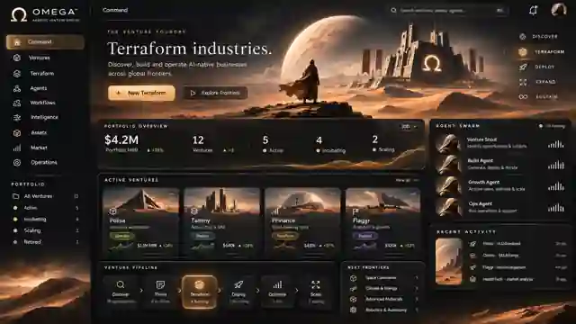
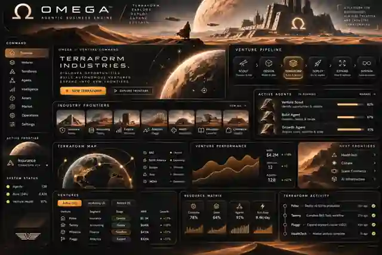

# Omega screenshot references

These are existing generated **concept screenshots**, not screenshots of a shipped application or accepted task-specific screens. The previews below are compressed derivatives; use the full-resolution originals for detailed visual review. Financial figures, activity, health and venture affiliations shown in the images are illustrative. Polsia is not an owned venture.

## Command and portfolio direction

**VIS-04**, 640 × 360 WebP preview. Warm industrial/desert command composition. Relevant to programme orientation, scoped command and portfolio composition, not proof that its metrics or controls work. Use OME-025/026/029 and the S03 specification for actual behaviour.

Expected preview SHA-256: `1bf40e6c0be0dee87f2d9f01cca062d11a2914c8e6c2c00e7df6fd8b6c38be23`.

Original: `a_cinematic_dark_sci_fi_dashboard_ui_for_omega.png`, 1672 × 941. Original SHA-256: `45e98a5df0149c82cd2046aaf5077c3b6e2d8f302e47366304718e1bd5ffe514`.

## Terraform and workflow direction

**VIS-15**, 640 × 427 WebP preview. Terraform programme and workflow composition. Relevant to OME-023/028/058 and S06/S24/S25 design exploration. It is not an executable state machine or proof of authority, durability or successful actions.

Expected preview SHA-256: `ee673f0954a16a61eba22a805a7e1b766f4a34a11479800c448de4c4d7ba9cc2`.

Original: `a_detailed_sci_fi_themed_ui_dashboard_design_for.png`, 1536 × 1024. Original SHA-256: `31f2a0a665c0b5b90284188a0dca450b1e1b776a785a4a3357c5117215bf272e`.

The importer verifies exact bytes and digests before committing these two previews and writes [the provenance manifest](manifest.json). Feature issues use commit-pinned image URLs so later branch changes cannot silently change their visual references.

## Complete original collection

[Open the original 20-image archive, contact sheet and source-image packs](https://chatgpt.com/space/page_8242867176f48191938ce84c887d3f31). This existing Space archive retains its access controls; it is not a public GitHub image attachment.

| Reference family | Archive IDs | Owning feature areas |
|---|---|---|
| Design systems, typography and icon studies | VIS-07, VIS-10, VIS-12, VIS-13, VIS-14, VIS-20 | OME-009–016 |
| Command and venture compositions | VIS-01–06, VIS-08, VIS-16–19 | OME-025, OME-026, OME-029 |
| Workflow and journey studies | VIS-09, VIS-11, VIS-15 | OME-023, OME-028, OME-058 |

VIS identifiers are archive indices, not chronology or new tickets. VIS-08 contains retired Colonise wording and is historical only. The source ZIPs preserve unchanged PNG originals and hashes. The GitHub-native copies here are two compressed browsing previews, not all 20 original files.

## Handoff rules

Use the [UI coverage](../ui-coverage.md), [feature specifications](../README.md) and [full UI atlas](https://chatgpt.com/space/page_bc328f44577081918e32b04b4daa5d61) for operational semantics. Select a task-specific reference before implementation. Rebuild UI text, data and controls as native components; do not slice screenshot controls into the app. Original SVG icon sources and individual decorative assets remain OME-012/016 deliverables. Preserve actual product originals without theme tinting. Screen acceptance needs rendered interaction, responsive, keyboard and recovery evidence.
