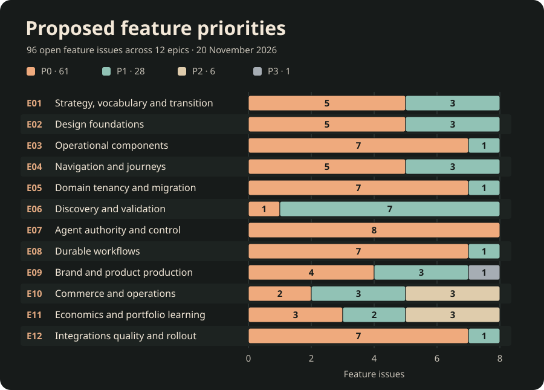
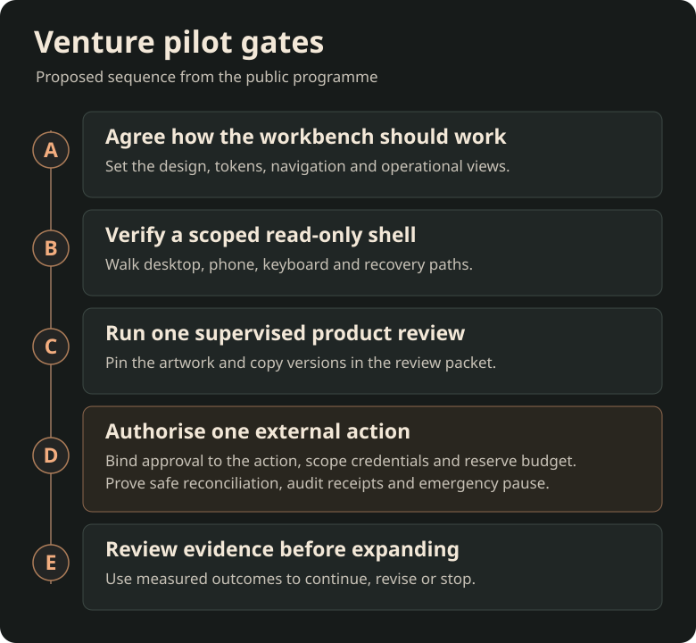

# Omega venture platform status

Snapshot from the public GitHub programme on 20 November 2026.

The programme defines a venture workbench for planning, producing and operating digital products with evidence and explicit human decisions. It is tracked alongside the existing Omega orchestration framework. The programme issue owns the delivery gates, and the programme import PR contains the proposed design contract, UI coverage and visual references. [Programme #8](https://github.com/castlemilk/omega/issues/8) · [Documentation import PR #93](https://github.com/castlemilk/omega/pull/93)

## Current state

- All 96 feature issues are open and labelled Proposed. All 12 epic trackers and the programme issue are open.
- The priority breakdown is 61 P0, 28 P1, 6 P2 and 1 P3. Priorities describe the plan. Each issue carries its own dependencies and acceptance criteria.
- The public programme checklist has all five delivery gates open. The first end-to-end milestone is a supervised internal digital-product review.

Priority counts derived from the open feature issues grouped by their epic links. [Programme issues](https://github.com/castlemilk/omega/issues?q=is%3Aissue+label%3A%22omega%3Aventure-platform%22)

## Pilot sequence

Original diagram of the proposed delivery gates. [Programme gates](https://github.com/castlemilk/omega/issues/8)

| Gate | Evidence needed to advance |
| --- | --- |
| A · Design agreement | Record the estate map and operating baseline. Agree the vocabulary, operational screens, and a pilot charter with an owner and stop conditions. [OME-003](https://github.com/castlemilk/omega/issues/12), [OME-006](https://github.com/castlemilk/omega/issues/24), [OME-007](https://github.com/castlemilk/omega/issues/28), [OME-008](https://github.com/castlemilk/omega/issues/33) |
| B · Scoped read-only shell | Verify ownership and role boundaries, then walk the complete journeys at desktop and phone widths, with keyboard and recovery checks. [OME-025](https://github.com/castlemilk/omega/issues/55), [OME-032](https://github.com/castlemilk/omega/issues/75), [OME-033](https://github.com/castlemilk/omega/issues/32), [OME-039](https://github.com/castlemilk/omega/issues/49) |
| C · Supervised internal review | Pin the artwork and copy versions, assemble the review packet, and record scientific, editorial and print readiness separately. [OME-007](https://github.com/castlemilk/omega/issues/28), [OME-069](https://github.com/castlemilk/omega/issues/87), [OME-071](https://github.com/castlemilk/omega/issues/100) |
| D · One authorised external action | Revalidate the exact approved action and scope. Exercise budget reservation, idempotency, reconciliation, audit receipts and emergency pause. Tie the hosted candidate to its source and rollback evidence. [OME-052](https://github.com/castlemilk/omega/issues/79), [OME-053](https://github.com/castlemilk/omega/issues/80), [OME-054](https://github.com/castlemilk/omega/issues/81), [OME-055](https://github.com/castlemilk/omega/issues/84), [OME-059](https://github.com/castlemilk/omega/issues/85), [OME-060](https://github.com/castlemilk/omega/issues/86), [OME-074](https://github.com/castlemilk/omega/issues/106), [OME-095](https://github.com/castlemilk/omega/issues/116) |
| E · Bounded operation | Use measured outcomes, failures and operator feedback to record a continue, revise or stop decision. [OME-088](https://github.com/castlemilk/omega/issues/103), [OME-096](https://github.com/castlemilk/omega/issues/117) |

Start with the operating baseline and pilot charter. Prove the scoped read paths before accepting a supervised review. Test a resumed approval, an expired approval and an unknown action outcome as separate cases before advancing to external dispatch. [OME-006](https://github.com/castlemilk/omega/issues/24), [OME-007](https://github.com/castlemilk/omega/issues/28), [OME-057](https://github.com/castlemilk/omega/issues/59), [OME-058](https://github.com/castlemilk/omega/issues/72), [OME-059](https://github.com/castlemilk/omega/issues/85), [OME-060](https://github.com/castlemilk/omega/issues/86)

Close a feature issue once its linked evidence meets the acceptance criteria and the decision is recorded. Include the source revision and fixture with local checks. Record device observations and hosted checks separately. For a release decision, match the reviewed source, artifact, environment, access boundary and rollback evidence. [OME-032](https://github.com/castlemilk/omega/issues/75), [OME-093](https://github.com/castlemilk/omega/issues/99), [OME-095](https://github.com/castlemilk/omega/issues/116), [OME-096](https://github.com/castlemilk/omega/issues/117)

## Feature index

Each epic links to its maintained checklist. Open a feature issue for its status, dependencies and acceptance criteria.

### [E01 · Strategy, vocabulary and transition](https://github.com/castlemilk/omega/issues/9)

- [OME-001 · Define product vocabulary and venture boundary](https://github.com/castlemilk/omega/issues/10)
- [OME-002 · Evaluate the Omega name and brand architecture](https://github.com/castlemilk/omega/issues/11)
- [OME-003 · Map the existing product estate and backlog](https://github.com/castlemilk/omega/issues/12)
- [OME-004 · Specify personas and measurable jobs to be done](https://github.com/castlemilk/omega/issues/25)
- [OME-005 · Build a source-backed competitor capability matrix](https://github.com/castlemilk/omega/issues/26)
- [OME-006 · Capture the current operating and UX baseline](https://github.com/castlemilk/omega/issues/24)
- [OME-007 · Define the digital-product pilot and exit criteria](https://github.com/castlemilk/omega/issues/28)
- [OME-008 · Establish programme sequencing and decision ownership](https://github.com/castlemilk/omega/issues/33)

### [E02 · Design foundations](https://github.com/castlemilk/omega/issues/13)

- [OME-009 · Establish the artistic direction and visual acceptance rubric](https://github.com/castlemilk/omega/issues/27)
- [OME-010 · Build the semantic token contract](https://github.com/castlemilk/omega/issues/29)
- [OME-011 · Define typography and operational density](https://github.com/castlemilk/omega/issues/30)
- [OME-012 · Develop an original mark and icon family](https://github.com/castlemilk/omega/issues/31)
- [OME-013 · Specify motion and spatial transitions](https://github.com/castlemilk/omega/issues/34)
- [OME-014 · Implement accessibility and input conventions](https://github.com/castlemilk/omega/issues/35)
- [OME-015 · Establish the component catalogue and visual regression harness](https://github.com/castlemilk/omega/issues/38)
- [OME-016 · Define imagery and editorial asset rules](https://github.com/castlemilk/omega/issues/36)

### [E03 · Operational components](https://github.com/castlemilk/omega/issues/14)

- [OME-017 · Build the venture registry component](https://github.com/castlemilk/omega/issues/39)
- [OME-018 · Build evidence inspection and provenance components](https://github.com/castlemilk/omega/issues/40)
- [OME-019 · Build the decision gate and exact change review](https://github.com/castlemilk/omega/issues/41)
- [OME-020 · Build the observable agent run timeline](https://github.com/castlemilk/omega/issues/42)
- [OME-021 · Build budget and cost components](https://github.com/castlemilk/omega/issues/43)
- [OME-022 · Build save receipts and recovery states](https://github.com/castlemilk/omega/issues/44)
- [OME-023 · Build workflow canvas and accessible step list](https://github.com/castlemilk/omega/issues/45)
- [OME-024 · Standardise forms, tables, alerts and empty states](https://github.com/castlemilk/omega/issues/50)

### [E04 · Navigation and journeys](https://github.com/castlemilk/omega/issues/15)

- [OME-025 · Build the scoped application shell](https://github.com/castlemilk/omega/issues/55)
- [OME-026 · Build the portfolio command view](https://github.com/castlemilk/omega/issues/64)
- [OME-027 · Build the three onboarding entry paths](https://github.com/castlemilk/omega/issues/65)
- [OME-028 · Build the venture creation and spawning journey](https://github.com/castlemilk/omega/issues/74)
- [OME-029 · Build the venture room](https://github.com/castlemilk/omega/issues/66)
- [OME-030 · Build the approval inbox and mobile decision detail](https://github.com/castlemilk/omega/issues/67)
- [OME-031 · Add contextual search and command composition](https://github.com/castlemilk/omega/issues/68)
- [OME-032 · Validate complete journeys and responsive behaviour](https://github.com/castlemilk/omega/issues/75)

### [E05 · Domain tenancy and migration](https://github.com/castlemilk/omega/issues/16)

- [OME-033 · Define tenant and resource ownership contracts](https://github.com/castlemilk/omega/issues/32)
- [OME-034 · Model ventures, brands, products and channels](https://github.com/castlemilk/omega/issues/37)
- [OME-035 · Model spawning lineage and portfolio membership](https://github.com/castlemilk/omega/issues/46)
- [OME-036 · Version strategic and executable objects](https://github.com/castlemilk/omega/issues/47)
- [OME-037 · Decide persistence and service evolution](https://github.com/castlemilk/omega/issues/48)
- [OME-038 · Define business events and provenance envelopes](https://github.com/castlemilk/omega/issues/51)
- [OME-039 · Implement scoped roles and service principals](https://github.com/castlemilk/omega/issues/49)
- [OME-040 · Rehearse backward-compatible migration and recovery](https://github.com/castlemilk/omega/issues/56)

### [E06 · Discovery and validation](https://github.com/castlemilk/omega/issues/17)

- [OME-041 · Build opportunity and evidence intake](https://github.com/castlemilk/omega/issues/57)
- [OME-042 · Normalise market signals and competitor records](https://github.com/castlemilk/omega/issues/69)
- [OME-043 · Implement transparent opportunity ranking](https://github.com/castlemilk/omega/issues/76)
- [OME-044 · Create experiment protocols and stop rules](https://github.com/castlemilk/omega/issues/70)
- [OME-045 · Build low-cost validation templates](https://github.com/castlemilk/omega/issues/77)
- [OME-046 · Ingest observations and assess outcomes](https://github.com/castlemilk/omega/issues/78)
- [OME-047 · Record continue, pivot, pause and stop decisions](https://github.com/castlemilk/omega/issues/83)
- [OME-048 · Produce the validation-to-build handoff](https://github.com/castlemilk/omega/issues/89)

### [E07 · Agent authority and control](https://github.com/castlemilk/omega/issues/18)

- [OME-049 · Create the versioned agent and capability registry](https://github.com/castlemilk/omega/issues/52)
- [OME-050 · Implement bounded execution mandates](https://github.com/castlemilk/omega/issues/58)
- [OME-051 · Implement deterministic policy evaluation](https://github.com/castlemilk/omega/issues/71)
- [OME-052 · Bind approvals to exact actions](https://github.com/castlemilk/omega/issues/79)
- [OME-053 · Enforce atomic hierarchical budget reservations](https://github.com/castlemilk/omega/issues/80)
- [OME-054 · Broker scoped tools and credentials](https://github.com/castlemilk/omega/issues/81)
- [OME-055 · Implement pause quarantine and intervention](https://github.com/castlemilk/omega/issues/84)
- [OME-056 · Establish adversarial and autonomy promotion evaluations](https://github.com/castlemilk/omega/issues/90)

### [E08 · Durable workflows](https://github.com/castlemilk/omega/issues/19)

- [OME-057 · Select the durable execution architecture](https://github.com/castlemilk/omega/issues/59)
- [OME-058 · Implement workflow definitions and run state](https://github.com/castlemilk/omega/issues/72)
- [OME-059 · Make external effects idempotent and reconcilable](https://github.com/castlemilk/omega/issues/85)
- [OME-060 · Resume human approval workflows](https://github.com/castlemilk/omega/issues/86)
- [OME-061 · Implement cancellation and compensating actions](https://github.com/castlemilk/omega/issues/91)
- [OME-062 · Add scheduling quotas and concurrency leases](https://github.com/castlemilk/omega/issues/92)
- [OME-063 · Validate outputs independently of generation](https://github.com/castlemilk/omega/issues/82)
- [OME-064 · Instrument runs and explain recovery](https://github.com/castlemilk/omega/issues/94)

### [E09 · Brand and product production](https://github.com/castlemilk/omega/issues/20)

- [OME-065 · Adapt existing digital assets to venture scope](https://github.com/castlemilk/omega/issues/53)
- [OME-066 · Create the venture brand-kit workspace](https://github.com/castlemilk/omega/issues/54)
- [OME-067 · Version production recipes and execution inputs](https://github.com/castlemilk/omega/issues/60)
- [OME-068 · Build asset review and comparison](https://github.com/castlemilk/omega/issues/61)
- [OME-069 · Separate scientific, editorial and print readiness](https://github.com/castlemilk/omega/issues/87)
- [OME-070 · Model offers packages and customer entitlements](https://github.com/castlemilk/omega/issues/62)
- [OME-071 · Assemble the launch readiness packet](https://github.com/castlemilk/omega/issues/100)
- [OME-072 · Define additional business archetype modules](https://github.com/castlemilk/omega/issues/105)

### [E10 · Commerce and operations](https://github.com/castlemilk/omega/issues/21)

- [OME-073 · Implement a selected channel's draft adapter](https://github.com/castlemilk/omega/issues/101)
- [OME-074 · Publish only an authorised release candidate](https://github.com/castlemilk/omega/issues/106)
- [OME-075 · Ingest orders and payment lifecycle events](https://github.com/castlemilk/omega/issues/107)
- [OME-076 · Deliver digital products with explicit entitlements](https://github.com/castlemilk/omega/issues/111)
- [OME-077 · Add customer support triage and review](https://github.com/castlemilk/omega/issues/112)
- [OME-078 · Build consent and communication policy records](https://github.com/castlemilk/omega/issues/95)
- [OME-079 · Build measured acquisition and content loops](https://github.com/castlemilk/omega/issues/113)
- [OME-080 · Detect operating anomalies and propose responses](https://github.com/castlemilk/omega/issues/114)

### [E11 · Economics and portfolio learning](https://github.com/castlemilk/omega/issues/22)

- [OME-081 · Establish metric definitions and data-quality contracts](https://github.com/castlemilk/omega/issues/63)
- [OME-082 · Implement the venture financial ledger](https://github.com/castlemilk/omega/issues/73)
- [OME-083 · Attribute execution and production costs](https://github.com/castlemilk/omega/issues/102)
- [OME-084 · Build portfolio economics and scenario views](https://github.com/castlemilk/omega/issues/108)
- [OME-085 · Produce capital allocation recommendations](https://github.com/castlemilk/omega/issues/115)
- [OME-086 · Build permissioned playbooks and venture memory](https://github.com/castlemilk/omega/issues/96)
- [OME-087 · Define transparent platform billing and entitlements](https://github.com/castlemilk/omega/issues/109)
- [OME-088 · Measure outcomes trust and operator leverage](https://github.com/castlemilk/omega/issues/103)

### [E12 · Integrations quality and rollout](https://github.com/castlemilk/omega/issues/23)

- [OME-089 · Define integration adapter and capability contracts](https://github.com/castlemilk/omega/issues/97)
- [OME-090 · Build the verified webhook inbox and reconciliation jobs](https://github.com/castlemilk/omega/issues/104)
- [OME-091 · Define privacy retention and deletion workflows](https://github.com/castlemilk/omega/issues/88)
- [OME-092 · Provide portable exports and safe imports](https://github.com/castlemilk/omega/issues/98)
- [OME-093 · Establish CI and regression release gates](https://github.com/castlemilk/omega/issues/99)
- [OME-094 · Define runtime observability and performance budgets](https://github.com/castlemilk/omega/issues/110)
- [OME-095 · Verify deployment provenance and migration readiness](https://github.com/castlemilk/omega/issues/116)
- [OME-096 · Run the staged pilot and capability rollout](https://github.com/castlemilk/omega/issues/117)
